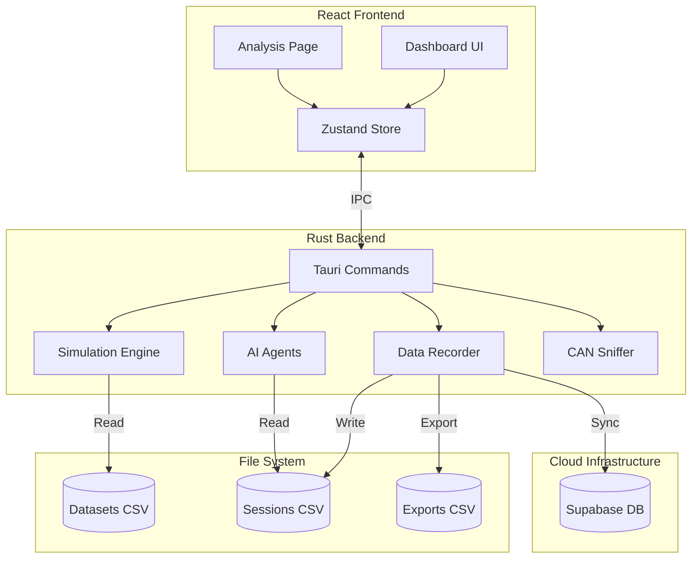

# 🚗 OBD-II Telemetry Dashboard

> A real-time automotive telemetry dashboard built with Tauri 2.0, Rust, and React. Playback real OBD-II data, analyze driving patterns with AI, and visualize car performance live.

[](https://tauri.app/)
[](https://www.rust-lang.org/)
[](https://reactjs.org/)
[](https://www.typescriptlang.org/)

## 📖 Table of Contents

- [Architecture](#architecture)
- [Features](#features)
- [Tech Stack](#tech-stack)
- [Quick Start](#quick-start)
- [Usage](#usage)
- [Development](#development)
- [Configuration](#configuration)
- [Contributing](#contributing)

## Architecture



## Features

### 🚗 Real Data Playback
- **3 Bundled Datasets**: City commute, highway driving, and mixed driving scenarios from a Toyota Etios 2014
- **27 OBD-II Parameters**: Engine RPM, vehicle speed, coolant temperature, throttle position, engine load, fuel level, and more
- **Adjustable Playback Speed**: 0.5x to 10x speed control for testing and demonstration
- **Smooth 10Hz Updates**: Real-time telemetry updates at 10 frames per second

### 📊 Live Dashboard
- **Interactive Gauges**: RPM, speed, and temperature with color-coded ranges
- **Telemetry Charts**: Real-time line charts showing historical data
- **CAN Frame Monitor**: Raw protocol-level message inspection
- **System Status**: Simulation state and connection indicators

### 💾 Data Recording & Export
- **Automatic Session Recording**: Captures all telemetry data to token-optimized CSV files
- **Cloud Sync**: Optional Supabase (PostgreSQL) integration for remote access and backup
- **One-Click Export**: Export current session or historical data to CSV
- **CSV Import**: Import external driving logs for analysis
- **LLM-Optimized Format**: Compact CSV structure reduces AI token usage by ~70% vs JSON

### 🤖 AI-Powered Analysis
- **Multi-Agent System**: Safety Coach, Efficiency Advisor, Diagnostics Expert
- **Intelligent Insights**: Get actionable recommendations on fuel efficiency, driving safety, and vehicle health
- **GPT-4 Integration**: Natural language analysis powered by OpenAI
- **Session Comparison**: Compare multiple driving sessions to track improvement

### 🎨 Car Animation Widget
- **Animated SVG Car**: Wheels spin based on vehicle speed
- **Dynamic Colors**: Car changes color based on driving state (idle/normal/accelerating/high-speed)
- **Visual Effects**: Exhaust smoke, high-RPM shake, speed lines, headlights, and tail lights
- **Status Badges**: Real-time indication of engine state and driving mode

## Tech Stack

**Frontend:**
- React 18 + TypeScript
- Vite 6
- Zustand (state management)
- Recharts (charting)
- Tailwind CSS

**Backend:**
- Rust (Tauri 2.0)
- Supabase (PostgreSQL) for cloud storage
- CSV parsing with `csv` crate
- Flexible dataset loading with automatic PID detection
- Dual-mode simulation (real data playback + random walk fallback)
- `tauri-plugin-dialog` for file operations

## 🚀 Quick Start

### Prerequisites

Ensure you have the following installed:

- **Node.js** 18+ and npm ([Download](https://nodejs.org/))
- **Rust** 1.70+ and Cargo ([Install](https://rustup.rs/))
- **Platform**: macOS, Linux, or Windows

### Installation

```bash
# 1. Clone the repository
git clone https://github.com/your-username/carDataProject.git
cd carDataProject

# 2. Install frontend dependencies
npm install

# 3. Run in development mode
npm run tauri dev
```

✅ The app will launch automatically at `http://localhost:1420/`

### Building for Production

```bash
# Create optimized production build
npm run tauri build

# Output will be in src-tauri/target/release/bundle/
```

## Usage

### Starting the Simulation

1. Click the **"Start Engine"** button in the dashboard
2. The green **"REAL DATA PLAYBACK"** badge indicates you're using real OBD-II data
3. Select a dataset from the dropdown to switch between driving scenarios
4. Adjust playback speed using the speed control (0.5x - 10x)

### Recording & Analysis

**Automatic Recording:**
- All sessions are saved to `src-tauri/data/sessions/` in compact CSV format
- Optional cloud backup to Supabase (see [Configuration](#configuration))

**Manual Export:**
1. Click the **"Export CSV"** button on any chart
2. Choose save location using the file picker
3. Exported files go to `src-tauri/data/exports/`

**AI Analysis:**
1. Navigate to the **"AI Analysis"** page
2. Select a recorded session from the list
3. Choose one or more AI agents:
   - 🛡️ **Safety Coach** - Analyzes risky maneuvers and speeding
   - ⚡ **Efficiency Advisor** - Suggests fuel-saving techniques
   - 🔧 **Diagnostics Expert** - Identifies potential vehicle issues
4. Click **"Analyze"** to generate comprehensive reports
5. View results with graphs, metrics, and actionable recommendations

### Available Datasets

| Dataset | Vehicle | Duration | Samples | Description |
|---------|---------|----------|---------|-------------|
| **City Commute** | Toyota Etios 2014 | 64 min | 3,853 | Stop-and-go city traffic |
| **Highway Driving** | Toyota Etios 2014 | 45 min | 2,709 | Sustained high-speed cruising |
| **Extended Mixed** | Toyota Etios 2014 | 59 min | 3,528 | Mixed city and highway driving |

*Source: [carOBD Dataset](https://github.com/eron93br/carOBD) (Open Source)*

### Dataset Format

Datasets are stored in `src-tauri/data/datasets/` as CSV files with the following structure:
- **Catalog**: `catalog.json` contains metadata for all datasets
- **CSV Files**: One row per second with 27 OBD-II parameters
- **Auto-Detection**: Column names are automatically mapped to PIDs

## Development

### Project Structure

```
carDataProject/
├── src/                    # React frontend
│   ├── components/         # UI components (Gauges, Charts, CarAnimation)
│   ├── pages/              # Dashboard and AI Analysis pages
│   ├── services/           # API client
│   └── store/              # Zustand state management
├── src-tauri/              # Rust backend
│   ├── src/
│   │   ├── agents/         # AI analysis agents
│   │   ├── can/            # CAN bus handling
│   │   ├── simulation/     # Dataset loading and playback engine
│   │   ├── storage/        # CSV recording & Supabase sync
│   │   └── commands.rs     # Tauri commands
│   └── data/               # Data storage
│       ├── datasets/       # Bundled OBD-II datasets
│       ├── sessions/       # Recorded sessions
│       └── exports/        # User exports
├── specs/                  # Feature specifications (speckit)
└── test/                   # Unit and integration tests
```

### Running Tests

```bash
# Run all Rust tests
cd src-tauri
cargo test

# Test dataset loading with verbose output
cargo test test_all_datasets_load -- --nocapture

# Run specific test
cargo test <test_name>

# Frontend tests (coming soon)
npm test
```

### Adding New Datasets

To add your own OBD-II CSV data:

1. **Prepare CSV file** with columns matching OBD-II PIDs (e.g., `ENGINE_RPM ()`)
2. **Place file** in `src-tauri/data/datasets/<category>/`
3. **Update catalog** in `catalog.json`:
   ```json
   {
     "id": "my-dataset",
     "name": "My Driving Session",
     "category": "custom",
     "file": "my-dataset.csv",
     "description": "Description here"
   }
   ```
4. **Restart app** to load the dataset
5. Select it from the dataset dropdown

## ⚙️ Configuration

### Supabase Setup (Optional)

To enable cloud storage and multi-device access:

1. Follow the detailed guide in [SUPABASE_SETUP.md](./SUPABASE_SETUP.md)
2. Create a `.env` file in the project root:
   ```bash
   SUPABASE_URL=https://your-project.supabase.co
   SUPABASE_ANON_KEY=your-anon-key-here
   ```
3. Restart the app - it will automatically sync sessions

### OpenAI API Key

For AI analysis features:

1. Get an API key from [OpenAI Platform](https://platform.openai.com/api-keys)
2. Add to `.env`:
   ```bash
   OPENAI_API_KEY=sk-your-key-here
   ```
3. AI analysis will now work on the Analysis page

## 🤝 Contributing

Contributions are welcome! Please follow these steps:

1. Fork the repository
2. Create a feature branch (`git checkout -b feature/amazing-feature`)
3. Commit your changes (`git commit -m 'Add amazing feature'`)
4. Push to the branch (`git push origin feature/amazing-feature`)
5. Open a Pull Request

### Development Guidelines

- Follow Rust formatting: `cargo fmt`
- Run linter: `cargo clippy`
- Ensure all tests pass: `cargo test`
- Use conventional commit messages

## 📄 License

This project is licensed under the MIT License - see the [LICENSE](LICENSE) file for details.

## 🙏 Acknowledgments

- [carOBD Dataset](https://github.com/eron93br/carOBD) - Real-world OBD-II data
- [Tauri](https://tauri.app/) - Cross-platform framework
- [Supabase](https://supabase.com/) - Cloud database infrastructure

## 📧 Contact

For questions or support, please open an issue on GitHub.

## Recommended IDE Setup

- [VS Code](https://code.visualstudio.com/) + [Tauri](https://marketplace.visualstudio.com/items?itemName=tauri-apps.tauri-vscode) + [rust-analyzer](https://marketplace.visualstudio.com/items?itemName=rust-lang.rust-analyzer)
