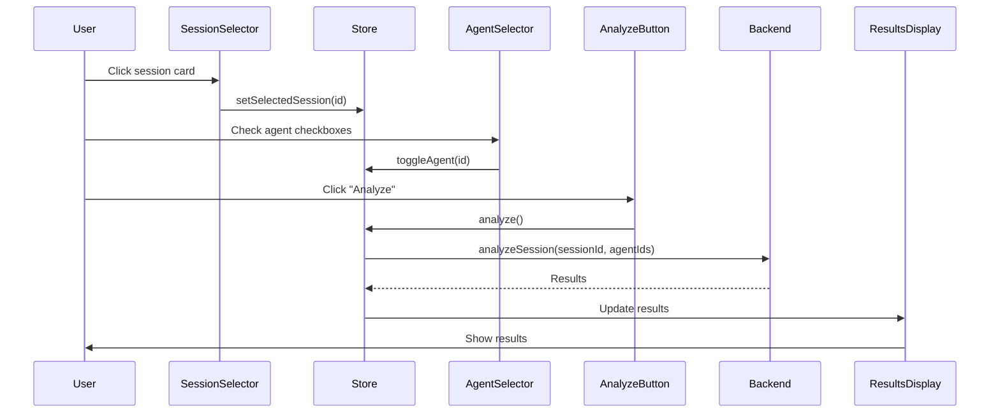

# Research: Unified AI Analysis Interface

## Overview

This document resolves technical unknowns and establishes patterns for implementing the unified AI analysis interface.

## Resolved Clarifications

### 1. Multi-Session Analysis (v1 Scope)

**Decision**: Single-session analysis for v1, multi-session as future enhancement

**Rationale**:
- Simplifies initial implementation and UX
- Agent backend currently expects single session ID
- Most common use case is analyzing individual sessions
- Can add multi-session comparison in v2

**Implementation**:
- SessionSelector allows selecting only 1 session at a time
- UI shows "Select a session" (singular)
- Future: Add checkbox mode for multi-select

### 2. Results Caching Strategy

**Decision**: Zustand store for in-memory caching, no persistence to Supabase

**Rationale**:
- Analysis results are derived data (can be regenerated)
- Supabase storage would add complexity and cost
- Users typically analyze once and move on
- Agent results may change as agents improve

**Implementation**:
```typescript
// agentStore.ts
interface AgentState {
  analysisResults: Record<string, AnalysisResult[]>;  // sessionId -> results
  // Cache cleared on app restart
}
```

**Cache invalidation**:
- Clear on session re-analysis
- Clear manually via "Clear Cache" button
- Auto-clear after N analyses (prevent memory bloat)

## Best Practices Research

### Progressive Disclosure in React

**Pattern**: Controlled Collapsible Sections

**Implementation approach**:
```typescript
const [expanded, setExpanded] = useState({
  sessions: true,    // Start expanded
  agents: true,      // Start expanded
  results: false     // Start collapsed (no results yet)
});

// After analysis completes:
setExpanded(prev => ({ ...prev, results: true }));

// Auto-scroll to results
resultsRef.current?.scrollIntoView({ behavior: 'smooth' });
```

**Benefits**:
- Reduces cognitive load
- Guides user through workflow
- Keeps context visible (collapsed sections show summary)

**Libraries considered**:
- Headless UI (Disclosure component) - ✅ Recommended
- Radix UI (Collapsible) - Alternative
- Custom implementation - Simple enough for our needs

### Supabase Session Query Patterns

**Current implementation** (from SessionHistoryPage):
```typescript
const sessions = await invoke<Session[]>('get_supabase_sessions');
```

**Existing Rust command**:
```rust
#[tauri::command]
pub async fn get_supabase_sessions(
    state: State<'_, Arc<SimulationState>>
) -> Result<Vec<SessionRow>, String>
```

**Decision**: Reuse existing command, no changes needed

**Data transformation**:
```typescript
// Transform SessionRow to UI card data
interface SessionCard {
  id: string;
  name: string;
  date: string;
  duration: string;
  dataPoints: number;
}
```

### State Management for Multi-Step Selection

**Pattern**: Unified selection state in Zustand store

**State shape**:
```typescript
interface UnifiedAnalysisState {
  // Selection
  selectedSessionId: string | null;
  selectedAgentIds: Set<string>;

  // Analysis
  isAnalyzing: boolean;
  analysisProgress?: number;  // For future progress bar

  // Results
  analysisResults: Record<string, AgentAnalysisResult>;
  analysisError: string | null;

  // Actions
  setSelectedSession: (id: string | null) => void;
  toggleAgent: (id: string) => void;
  selectAllAgents: () => void;
  analyze: () => Promise<void>;
  clearResults: () => void;
}
```

**Benefits**:
- Single source of truth
- Easy to persist to localStorage if needed later
- Clear action boundaries
- Testable

**Alternative considered**: React Context + useReducer
- **Rejected**: Zustand already in use, simpler API, better DevTools

### Error Boundary Patterns

**Pattern**: Component-level error boundaries for each section

**Implementation**:
```typescript
// components/analysis/ErrorBoundary.tsx
class AnalysisErrorBoundary extends React.Component {
  // Catches errors in section, shows retry UI
}

// Usage:
<ErrorBoundary fallback={<RetrySection />}>
  <SessionSelector />
</ErrorBoundary>
```

**Error types to handle**:
1. **Session fetch failure**: Show reload button
2. **Agent fetch failure**: Show retry with error message
3. **Analysis failure**: Show which agents failed, allow retry
4. **Network errors**: Toast notification + retry

**User-friendly error messages**:
- ❌ "Network request failed"
- ✅ "Couldn't load sessions. Check your connection and try again."

## Component Architecture

### Component Hierarchy

```
UnifiedAnalysisPage
├── SessionSelector
│   ├── SessionCard (multiple)
│   └── EmptyState
├── AgentSelector
│   ├── AgentCard (multiple, reused from existing)
│   └── SelectAllButton
├── AnalyzeButton
│   └── LoadingSpinner (when analyzing)
└── ResultsDisplay
    ├── AgentResultCard (per agent)
    │   ├── ResultSummary
    │   ├── InsightsList
    │   └── RecommendationsList
    └── EmptyState
```

### Component Responsibilities

**SessionSelector**:
- Fetches sessions via Tauri command
- Displays as card grid
- Manages selection state (single)
- Shows loading/error states

**AgentSelector**:
- Fetches agents via agentStore
- Displays as card grid with checkboxes
- Manages multi-selection
- Shows "Select All" control

**AnalyzeButton**:
- Validates selection (session + agent)
- Triggers analysis
- Shows progress/loading
- Disabled states

**ResultsDisplay**:
- Collapsible sections per agent
- Expandable/collapsible results
- Export/share actions
- Empty state when no results

## Data Flow

### Analysis Flow



### State Transitions

```
Initial State:
  selectedSessionId: null
  selectedAgentIds: []
  results: {}

After Session Selection:
  selectedSessionId: "123"
  selectedAgentIds: []
  results: {}

After Agent Selection:
  selectedSessionId: "123"
  selectedAgentIds: ["fuel-coach", "safety-advisor"]
  results: {}

During Analysis:
  isAnalyzing: true
  // ... same state ...

After Analysis:
  isAnalyzing: false
  results: {
    "fuel-coach": { insights: [...], score: 85 },
    "safety-advisor": { insights: [...], score: 92 }
  }
```

## Performance Considerations

### Optimizations

1. **Session list**: Paginate if >100 sessions (unlikely in v1)
2. **Agent cards**: Memo to prevent re-renders
3. **Results**: Virtual scrolling if results are large (future)
4. **Analysis**: Show progress indicator for long-running analyses

### Bundle Size

**New components**: ~15KB gzipped
**No new dependencies**: Using existing libs
**Code splitting**: Lazy load UnifiedAnalysisPage

## Accessibility

### Keyboard Navigation

- **Tab**: Through selections
- **Space**: Select/deselect cards and agents
- **Enter**: Trigger analyze
- **Escape**: Close expanded sections

### Screen Reader

- ARIA labels for all interactive elements
- Announce selection changes
- Announce analysis progress
- Announce results arrival

### Color Contrast

- Follow WCAG AA (4.5:1 for text)
- Selected state uses both color AND border
- Focus indicators clearly visible

## Mobile Considerations (Future)

While Tauri is desktop-first, responsive design principles:

- **Session cards**: Stack vertically on small screens
- **Agent grid**: Single column on mobile
- **Results**: Accordion view (one expanded at a time)
- **Analyze button**: Fixed at bottom on mobile

## Testing Strategy

### Unit Tests

```typescript
// SessionSelector.test.tsx
describe('SessionSelector', () => {
  it('displays sessions as cards', ...)
  it('highlights selected session', ...)
  it('shows loading state', ...)
  it('shows error state with retry', ...)
});

// AgentSelector.test.tsx
describe('AgentSelector', () => {
  it('allows multi-select', ...)
  it('shows selection count', ...)
  it('select all toggles all agents', ...)
});

// AnalyzeButton.test.tsx
describe('AnalyzeButton', () => {
  it('is disabled without selection', ...)
  it('shows loading during analysis', ...)
  it('displays error on failure', ...)
});
```

### Integration Tests

```typescript
describe('Unified Analysis Flow', () => {
  it('completes full analysis flow', async () => {
    // 1. Select session
    // 2. Select agents
    // 3. Click analyze
    // 4. Verify results displayed
  });
});
```

## Migration Plan

### Phase 1: Create New Components (No Breaking Changes)

1. Create `UnifiedAnalysisPage.tsx`
2. Create sub-components in `components/analysis/`
3. Add route `/analysis-new` (temporary)
4. Test in parallel with old pages

### Phase 2: Switch Over

1. Update route `/analysis` to point to new page
2. Remove `/agents` route
3. Update navigation (single "AI Analysis" link)
4. Remove old `AnalysisPage.tsx` and `AgentDashboard.tsx`

### Phase 3: Cleanup

1. Remove unused components
2. Remove unused imports
3. Update tests
4. Remove legacy CSS

## Conclusion

### Key Decisions Summary

| Question | Decision | Rationale |
|----------|----------|-----------|
| Multi-session? | No (v1) | Simpler UX, agent API limitation |
| Results caching? | Zustand (memory) | Derived data, no persistence needed |
| Collapsible UI? | Yes, Headless UI | Progressive disclosure, familiar pattern |
| State management? | Extend agentStore | Already in use, simpler |
| Error handling? | Error boundaries + toast | Graceful degradation |

### Risks & Mitigations

| Risk | Impact | Mitigation |
|------|--------|------------|
| Analysis timeout | User frustration | Show progress, allow cancel |
| Agent API rate limit | Failed analysis | Queue requests, show limits |
| Large result sets | Memory bloat | Limit results, paginate |
| Session list performance | Slow load | Pagination, virtual scrolling |

### Success Metrics

- ✅ Time to complete analysis: <10 seconds
- ✅ User can analyze within 3 clicks
- ✅ All states have clear UI feedback
- ✅ No layout shifts during loading
- ✅ Accessible to keyboard and screen readers

---

**All clarifications resolved. Ready for Phase 1 (Design & Contracts).**
