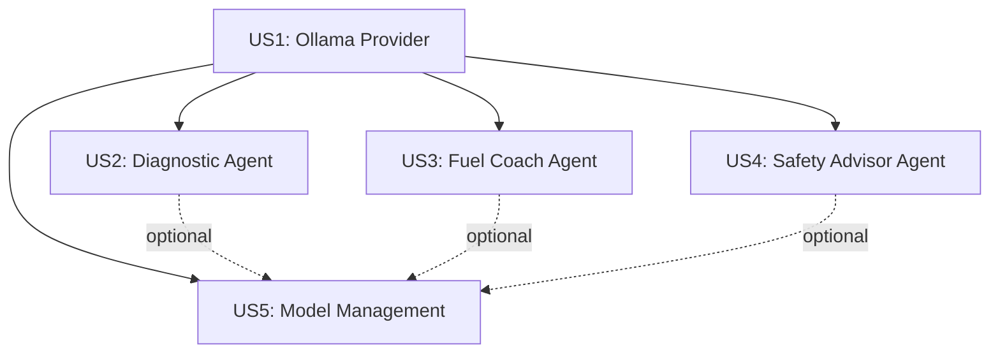

# Tasks: LLM Integration for AI Agents (Local Ollama)

**Feature**: 014-llm-integration
**Branch**: `014-llm-integration`
**Total Tasks**: 49

## Overview

Integrate local Llama LLM via Ollama to power the three existing AI agents (Diagnostic, Fuel Coach, Safety Advisor) with actual natural language analysis capabilities. All processing happens locally on the user's computer for privacy and zero cost.

## User Stories (from spec.md)

**US1 [P1]**: Ollama Provider Integration
**Goal**: Create core infrastructure to communicate with local Ollama service
**Test Criteria**: Can connect to Ollama, send prompts, receive responses

**US2 [P1]**: Diagnostic Agent LLM Integration
**Goal**: Update Diagnostic Agent to use Ollama for vehicle health analysis
**Test Criteria**: Agent generates AI-powered insights from telemetry data

**US3 [P2]**: Fuel Coach Agent LLM Integration
**Goal**: Update Fuel Coach Agent to use Ollama for fuel efficiency advice
**Test Criteria**: Agent provides personalized fuel-saving recommendations

**US4 [P2]**: Safety Advisor Agent LLM Integration
**Goal**: Update Safety Advisor Agent to use Ollama for driving safety analysis
**Test Criteria**: Agent identifies risky driving patterns and suggests improvements

**US5 [P3]**: Model Management UI
**Goal**: Add Tauri commands and frontend UI for managing Ollama models
**Test Criteria**: User can check Ollama status, list/download models from settings

---

## Phase 1: Setup & Dependencies

**Goal**: Add required dependencies and update environment configuration

- [ ] T001 Add `ollama-rs = "0.3.2"` to /Users/roopemakiranta/KOODIT/carDataProject/src-tauri/Cargo.toml dependencies
- [ ] T002 Add `schemars = { version = "0.8", features = ["derive"] }` to /Users/roopemakiranta/KOODIT/carDataProject/src-tauri/Cargo.toml dependencies for JSON schema support
- [ ] T003 Add Ollama configuration variables to /Users/roopemakiranta/KOODIT/carDataProject/src-tauri/.env.example (OLLAMA_MODEL, OLLAMA_TIMEOUT_SECONDS)
- [ ] T004 Run `cargo build` to verify dependencies compile successfully

---

## Phase 2: Foundational - Ollama Provider Module (US1)

**Goal**: Create reusable Ollama provider that all agents can use
**Independent Test**: Provider can connect to Ollama and generate text responses

**Story**: US1 - Ollama Provider Integration

- [ ] T005 [US1] Create providers module directory at /Users/roopemakiranta/KOODIT/carDataProject/src-tauri/src/agents/providers/mod.rs
- [ ] T006 [US1] Implement OllamaProvider struct in /Users/roopemakiranta/KOODIT/carDataProject/src-tauri/src/agents/providers/ollama.rs with `new()`, `health_check()`, and `generate()` methods
- [ ] T007 [US1] Add `analyze_session()` method to OllamaProvider that formats telemetry data into prompts in /Users/roopemakiranta/KOODIT/carDataProject/src-tauri/src/agents/providers/ollama.rs
- [ ] T008 [US1] Implement JSON response parsing with fallback to freeform text in OllamaProvider in /Users/roopemakiranta/KOODIT/carDataProject/src-tauri/src/agents/providers/ollama.rs
- [ ] T009 [US1] Add error handling for Ollama unavailable/timeout scenarios in /Users/roopemakiranta/KOODIT/carDataProject/src-tauri/src/agents/providers/ollama.rs
- [ ] T010 [US1] Export OllamaProvider from /Users/roopemakiranta/KOODIT/carDataProject/src-tauri/src/agents/mod.rs

---

## Phase 3: Diagnostic Agent AI Integration (US2)

**Goal**: Replace Diagnostic Agent's rule-based logic with LLM-powered analysis
**Independent Test**: Diagnostic Agent analyzes session and returns AI-generated health insights

**Story**: US2 - Diagnostic Agent LLM Integration

- [ ] T011 [US2] Define Diagnostic Agent system prompt in /Users/roopemakiranta/KOODIT/carDataProject/src-tauri/src/agents/implementations/diagnostic.rs (ASE technician persona, focus on mechanical health)
- [ ] T012 [US2] Define ParsedDiagnosticAnalysis struct with health_score, critical_issues, warnings, recommendations in /Users/roopemakiranta/KOODIT/carDataProject/src-tauri/src/agents/implementations/diagnostic.rs
- [ ] T013 [US2] Add OllamaProvider field to DiagnosticAgent struct in /Users/roopemakiranta/KOODIT/carDataProject/src-tauri/src/agents/implementations/diagnostic.rs
- [ ] T014 [US2] Implement `build_diagnostic_prompt()` method that formats telemetry into structured prompt in /Users/roopemakiranta/KOODIT/carDataProject/src-tauri/src/agents/implementations/diagnostic.rs
- [ ] T015 [US2] Update DiagnosticAgent::analyze() to call OllamaProvider and parse response in /Users/roopemakiranta/KOODIT/carDataProject/src-tauri/src/agents/implementations/diagnostic.rs
- [ ] T016 [US2] Implement `parse_diagnostic_response()` to convert JSON to Insight/Recommendation types in /Users/roopemakiranta/KOODIT/carDataProject/src-tauri/src/agents/implementations/diagnostic.rs
- [ ] T017 [US2] Add fallback to existing rule-based logic if Ollama fails in /Users/roopemakiranta/KOODIT/carDataProject/src-tauri/src/agents/implementations/diagnostic.rs
- [ ] T018 [US2] Update DiagnosticAgent::metadata() to reflect "AI-powered" in description and set privacy_level to LocalOnly in /Users/roopemakiranta/KOODIT/carDataProject/src-tauri/src/agents/implementations/diagnostic.rs

---

## Phase 4: Fuel Coach Agent AI Integration (US3)

**Goal**: Enable Fuel Coach to provide personalized fuel-saving advice via LLM
**Independent Test**: Fuel Coach analyzes driving patterns and suggests efficiency improvements

**Story**: US3 - Fuel Coach Agent LLM Integration

- [ ] T019 [P] [US3] Define Fuel Coach system prompt in /Users/roopemakiranta/KOODIT/carDataProject/src-tauri/src/agents/implementations/fuel_coach.rs (fuel efficiency expert persona, focus on behavior patterns)
- [ ] T020 [P] [US3] Define ParsedFuelAnalysis struct with mpg_potential, behaviors, techniques, savings in /Users/roopemakiranta/KOODIT/carDataProject/src-tauri/src/agents/implementations/fuel_coach.rs
- [ ] T021 [US3] Add OllamaProvider field to FuelCoachAgent struct in /Users/roopemakiranta/KOODIT/carDataProject/src-tauri/src/agents/implementations/fuel_coach.rs
- [ ] T022 [US3] Implement `build_fuel_prompt()` highlighting acceleration patterns, idle time, speed consistency in /Users/roopemakiranta/KOODIT/carDataProject/src-tauri/src/agents/implementations/fuel_coach.rs
- [ ] T023 [US3] Update FuelCoachAgent::analyze() to use OllamaProvider in /Users/roopemakiranta/KOODIT/carDataProject/src-tauri/src/agents/implementations/fuel_coach.rs
- [ ] T024 [US3] Implement `parse_fuel_response()` to extract fuel-saving recommendations in /Users/roopemakiranta/KOODIT/carDataProject/src-tauri/src/agents/implementations/fuel_coach.rs
- [ ] T025 [US3] Add fallback logic for Ollama unavailability in /Users/roopemakiranta/KOODIT/carDataProject/src-tauri/src/agents/implementations/fuel_coach.rs
- [ ] T026 [US3] Update metadata to reflect AI capabilities in /Users/roopemakiranta/KOODIT/carDataProject/src-tauri/src/agents/implementations/fuel_coach.rs

---

## Phase 5: Safety Advisor Agent AI Integration (US4)

**Goal**: Enable Safety Advisor to detect risky driving via LLM analysis
**Independent Test**: Safety Advisor identifies aggressive maneuvers and suggests safer driving techniques

**Story**: US4 - Safety Advisor Agent LLM Integration

- [ ] T027 [P] [US4] Define Safety Advisor system prompt in /Users/roopemakiranta/KOODIT/carDataProject/src-tauri/src/agents/implementations/safety_advisor.rs (defensive driving instructor persona, focus on risk assessment)
- [ ] T028 [P] [US4] Define ParsedSafetyAnalysis struct with safety_score, high_risk_events, patterns, training_recommendations in /Users/roopemakiranta/KOODIT/carDataProject/src-tauri/src/agents/implementations/safety_advisor.rs
- [ ] T029 [P] [US4] Add OllamaProvider field and implement `build_safety_prompt()` in /Users/roopemakiranta/KOODIT/carDataProject/src-tauri/src/agents/implementations/safety_advisor.rs
- [ ] T030 [US4] Update SafetyAdvisorAgent::analyze() to use Ollama and parse safety insights in /Users/roopemakiranta/KOODIT/carDataProject/src-tauri/src/agents/implementations/safety_advisor.rs
- [ ] T031 [US4] Add fallback and update metadata in /Users/roopemakiranta/KOODIT/carDataProject/src-tauri/src/agents/implementations/safety_advisor.rs

---

## Phase 6: Model Management UI (US5)

**Goal**: Allow users to manage Ollama models from app settings
**Independent Test**: User can see Ollama status, available models, and download new models

**Story**: US5 - Model Management UI

- [ ] T032 [P] [US5] Add `check_ollama_status()` Tauri command in /Users/roopemakiranta/KOODIT/carDataProject/src-tauri/src/commands.rs
- [ ] T033 [P] [US5] Add `list_ollama_models()` Tauri command in /Users/roopemakiranta/KOODIT/carDataProject/src-tauri/src/commands.rs
- [ ] T034 [P] [US5] Add `download_ollama_model(model: String)` Tauri command in /Users/roopemakiranta/KOODIT/carDataProject/src-tauri/src/commands.rs
- [ ] T035 [P] [US5] Add `get_recommended_model()` Tauri command that returns "llama3.2:3b" in /Users/roopemakiranta/KOODIT/carDataProject/src-tauri/src/commands.rs
- [ ] T036 [US5] Register new Tauri commands in /Users/roopemakiranta/KOODIT/carDataProject/src-tauri/src/lib.rs invoke_handler
- [ ] T037 [P] [US5] Create OllamaSettings component in /Users/roopemakiranta/KOODIT/carDataProject/src/components/settings/OllamaSettings.tsx showing connection status
- [ ] T038 [P] [US5] Add model list display and download button to OllamaSettings in /Users/roopemakiranta/KOODIT/carDataProject/src/components/settings/OllamaSettings.tsx
- [ ] T039 [US5] Add OllamaSettings to Settings page in /Users/roopemakiranta/KOODIT/carDataProject/src/pages/SettingsPage.tsx
- [ ] T040 [US5] Add informational banner about local AI processing in /Users/roopemakiranta/KOODIT/carDataProject/src/components/settings/OllamaSettings.tsx

---

## Phase 7: Documentation & Testing

**Goal**: Update all documentation and ensure robust error handling

### Documentation Updates

- [ ] T041 Update README.md AI Analysis section: Change "Coming Soon" to "✅ Local AI Analysis", replace "OpenAI Integration" with "Ollama (Llama 3.2)" in /Users/roopemakiranta/KOODIT/carDataProject/README.md
- [ ] T042 Add "AI Setup (Optional)" section to README.md with Ollama installation steps for macOS/Windows/Linux in /Users/roopemakiranta/KOODIT/carDataProject/README.md
- [ ] T043 Update Tech Stack section in README.md to include `ollama-rs` crate and mention local AI processing in /Users/roopemakiranta/KOODIT/carDataProject/README.md
- [ ] T044 Create /Users/roopemakiranta/KOODIT/carDataProject/docs/OLLAMA_SETUP.md with detailed guide including model download, troubleshooting, privacy benefits

### Testing

- [ ] T045 Test all three agents with actual Ollama running `llama3.2:3b` model
- [ ] T046 Test graceful degradation when Ollama service is stopped
- [ ] T047 Verify agent metadata correctly shows LocalOnly privacy level
- [ ] T048 Test model download UI flow (if model not present)
- [ ] T049 Update agent icons/descriptions in frontend to indicate AI-powered analysis

---

## Dependencies & Parallel Execution

### Story Dependencies



**Critical Path**: US1 must complete before US2, US3, US4
**Parallel Opportunities**: US2, US3, US4, US5 can be developed in parallel after US1

### Task Parallelization

**Phase 2 (US1)**: Sequential (foundation for all agents)
**Phase 3-5 (US2-US4)**: Can be done in parallel after US1 completes
**Phase 6 (US5)**: Can be done in parallel with US2-US4

**Parallel Groups**:
- After T010: T011-T018 (US2), T019-T026 (US3), T027-T031 (US4), T032-T040 (US5) can all proceed independently
- T019-T020, T027-T028 are marked [P] as they only define structs/prompts (no shared state)
- T032-T035, T037-T038 are marked [P] as they work on different files

---

## Implementation Strategy

### MVP Scope (Recommended)

**Sprint 1**: US1 + US2 (Ollama Provider + Diagnostic Agent)
- Establishes LLM integration pattern
- Proves end-to-end AI analysis works
- Provides immediate value (vehicle health insights)

**Sprint 2**: US3 + US4 (Remaining Agents)
- Apply proven pattern to Fuel Coach and Safety Advisor
- Fast implementation (reuse provider, prompts are main difference)

**Sprint 3**: US5 + Polish (Model Management + Documentation)
- User-facing controls for Ollama
- Setup documentation
- Error handling refinements

### Testing Approach

**Manual Testing** (recommended for MVP):
1. Install Ollama: `brew install ollama`
2. Download model: `ollama pull llama3.2:3b`
3. Start Ollama: `ollama serve`
4. Run app and analyze a session with each agent
5. Stop Ollama and verify fallback to rule-based logic

**Automated Testing** (future):
- Mock OllamaProvider responses
- Test prompt formatting
- Test JSON parsing with various LLM outputs

---

## Success Criteria Checklist

From spec.md and research.md:

**Functional**:
- [ ] Ollama integration working end-to-end (all agents connect successfully)
- [ ] All three agents generate AI-powered insights (not placeholder data)
- [ ] Responses relevant to telemetry data (insights cite specific sensor readings)
- [ ] Error handling works (graceful fallback when Ollama unavailable)
- [ ] Model management UI functional (can check status, download models)

**Performance**:
- [ ] Analysis completes in <30 seconds with Llama 3.2 3B
- [ ] First token latency <200ms
- [ ] Memory usage <8GB total (app + model)
- [ ] No UI blocking during LLM calls (async execution)

**Quality**:
- [ ] AI insights more detailed than original rule-based placeholders
- [ ] JSON parsing reliability >95% (handles malformed responses)
- [ ] Recommendations actionable and specific (cite thresholds, explain why)

**User Experience**:
- [ ] Clear setup instructions if Ollama missing
- [ ] Privacy messaging prominent ("runs locally on your computer")
- [ ] Model selection available in settings
- [ ] Offline capability confirmed (no internet required after setup)

---

## Notes

**Research Decision**: Originally spec mentioned Google Gemini, but research.md chose local Ollama for privacy, zero cost, and offline capability. These tasks implement the Ollama approach.

**File Structure**:
```
src-tauri/src/agents/
├── providers/
│   ├── mod.rs          # New module
│   └── ollama.rs       # OllamaProvider implementation
├── implementations/
│   ├── diagnostic.rs   # Update with LLM integration
│   ├── fuel_coach.rs   # Update with LLM integration
│   └── safety_advisor.rs # Update with LLM integration
└── mod.rs              # Export providers module
```

**Key Design Decisions**:
- Use `ollama-rs` crate (not raw reqwest) for idiomatic Rust API
- Fallback to rule-based logic if Ollama unavailable (graceful degradation)
- JSON mode for structured output (health scores, insights list, recommendations)
- Agent-specific system prompts (diagnostic vs fuel vs safety personas)
- LocalOnly privacy level (data never leaves user's computer)
